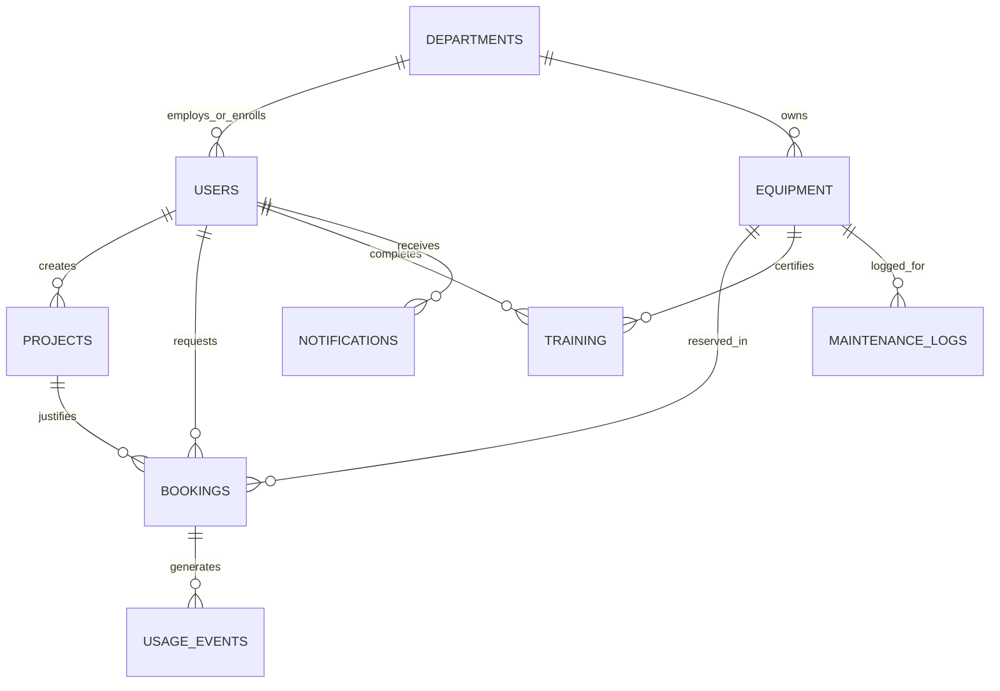

# LabLink · Campus Laboratory Resource Exchange

LabLink is an intelligent, fairness-driven campus laboratory resource management platform. It matches academic and capstone project requirements to compatible laboratory equipment across departmental boundaries, resolves competing reservation requests through a transparent, explainable scoring policy, and provides real-time utilization insights to support cross-department resource sharing.

---

## 1. Project Overview

Academic institutions invest heavily in specialized laboratories (e.g., ECE oscilloscopes, CSE GPU clusters, Mechanical 3D printers and CNC mills, Physics thermal imaging cameras). However, these high-value resources often sit siloed within individual departments, underutilized by departmental peers while students and researchers from other departments face barriers accessing them for cross-disciplinary capstone projects.

**LabLink** provides a unified campus laboratory exchange that:
- Connects student projects to specialized laboratory assets across all departments.
- Understands natural-language project descriptions to recommend technically suitable equipment.
- Enforces safety prerequisites, operational status, and capacity limits.
- Resolves scheduling competition using a deterministic, multi-factor fairness scoring model.
- Maintains institutional governance through human-in-the-loop approvals and an immutable audit trail.
- Implements an unencumbered prototype interface with zero login friction (immediate role switching between students, faculty, lab technicians, and administrators).

---

## 2. Selected Vertical

- **Vertical**: Higher Education & Academic Research Infrastructure (Higher Ed Lab Operations & Cross-Department Resource Sharing).
- **Stakeholders**:
  - **Students / Capstone Teams**: Need specialized equipment matched to their project deadlines without administrative departmental runarounds.
  - **Faculty Reviewers & Department Heads (HODs)**: Need an objective, policy-grounded recommendation to arbitrate competing requests fairly without manual spreadsheet tracking.
  - **Lab Technicians**: Manage equipment health, verify mandatory safety training, log scheduled maintenance, and supervise physical check-ins.
  - **Campus Administrators**: Need macro-level visibility into laboratory demand, cross-department utilization, and idle capacity.

---

## 3. Problem Statement

1. **Departmental Siloing**: Equipment purchased by one engineering department remains invisible or administratively locked to students in adjacent disciplines.
2. **First-Come, First-Served Inequity**: Naive booking systems favor early hoarders over urgent academic deadlines and students with genuine project needs.
3. **Safety & Training Non-Compliance**: High-risk machinery (laser cutters, CNC routers, high-voltage test rigs) is frequently booked without verified student safety clearances.
4. **Lack of Explainability in Allocation**: When requests conflict, manual rejections lead to student frustration due to opaque reasoning.
5. **Operational Downtime Blindspots**: Broken or recalibrating instruments accept reservations when maintenance states are decoupled from booking calendars.

---

## 4. Core Features

- **Cross-Department Equipment Catalog**: Filterable catalog with search across specifications, locations, departments, operating statuses, and training prerequisites.
- **Natural Language Project-to-Resource Search**: Search interface supporting project prompts (e.g., *"autonomous thermal rover with wireless telemetry"*) to extract technical keywords, units, and categories.
- **Explainable Fairness Scoring Engine**: Computes a deterministic 0–100 fairness score based on academic deadline proximity, student booking history, departmental balance, and specification match.
- **Intelligent Slot Recommendation & Alternative Suggestions**: When equipment is congested or fully booked, the system automatically suggests equivalent operational alternatives with available capacity.
- **Safety Training Verification Gate**: Blocks booking submissions and approvals if the student has not completed required safety certifications.
- **Faculty Review & Arbitration Dashboard**: Prioritized queue for pending requests with complete component score breakdowns, student history, and one-click approvals/rejections with mandatory notes.
- **Equipment Condition & Maintenance**: Track Available, In Use, Under Maintenance and Under Inspection states; collect fault and student damage reports with optional photographs; keep maintenance history, notify technicians and faculty, and require technician or administrator clearance before returning equipment to discovery and scheduling.
- **Resource Insights & Campus Analytics**: Visual utilization metrics, demand by home department, total hours booked vs. actual usage, and recent audit activity.
- **Real-Time Notification Triggers**: SQLite-backed notification triggers that alert students and staff on request submissions, approvals, rejections, status changes, and training updates.
- **Verified Booking Usage**: Confirmed reservations are matched to check-in/check-out records. Missing check-ins become neutral review candidates after a configurable grace period; students are notified and staff must verify a no-show before it enters allocation history.
- **Right-Sized Sessions**: Students provide estimated equipment-use hours. Task and equipment limits plus current slot capacity inform duration suggestions. Any change to an approved reservation duration requires staff approval.
- **Interactive Persona Switcher (Zero-Login Prototype)**: Instantly switch between Student (Aarav, Priya, Kabir), Faculty Reviewer (Dr. Meera Rao, Dr. Rohan Das), Lab Technician, and Campus Admin directly from the UI header.

---

## 5. Technology Stack

- **Runtime**: Node.js (v22.5.0+ or v24.x LTS recommended).
- **Backend Architecture**: Native Node.js HTTP server (`node:http`) with custom lightweight REST router. Zero heavy third-party framework overhead.
- **Database Engine**: Built-in `node:sqlite` (`DatabaseSync`) with Write-Ahead Logging (WAL) enabled and foreign key enforcement.
- **Frontend Architecture**: Native modern ES modules (`public/app.js`), semantic HTML5 (`public/index.html`), and responsive custom CSS design system (`public/styles.css`). Zero bundlers, compilers, or heavy node_modules dependencies.
- **AI / NLP Engine**: Hybrid dual-mode extraction:
  - *Local Deterministic NLP*: In-memory regex tokenization, engineering unit detection, frequency filtering, and synonym expansion.
  - *Optional LLM Extraction*: OpenAI-compatible JSON schema-validated client (GPT-4o-mini, Groq, Ollama, OpenRouter).
- **Footprint**: **Under 1 MB** complete repository footprint (strictly satisfying prototype resource limits).

---

## 6. System Architecture

```
┌────────────────────────────────────────────────────────────────────────┐
│                        BROWSER / CLIENT UI                             │
│  - Semantic HTML5 / Vanilla ES Modules / Responsive CSS Design System   │
│  - Instant Demo Persona Switcher (Student, Faculty, Technician, Admin)  │
│  - Views: Discover & Match, My Requests, Review Queue, Resource Insights│
└───────────────────────────────────┬────────────────────────────────────┘
                                    │ HTTP / REST API (Port 3000)
                                    ▼
┌────────────────────────────────────────────────────────────────────────┐
│                    NODE.JS APPLICATION SERVER                          │
│                                                                        │
│  ┌───────────────────────┐  ┌──────────────────────────────────────┐  │
│  │   Static File Router  │  │         REST API Controller          │  │
│  │  - Path Traversal Guard│  │  - Bootstrap, Catalog & Equipment    │  │
│  │  - MIME Type Resolution│  │  - Projects & Assistant Matcher     │  │
│  └───────────────────────┘  │  - Bookings, Review & Audit Log     │  │
│                             │  - Real-time Notifications API       │  │
│                             └──────────┬───────────────────────────┘  │
│                                        │                              │
│              ┌─────────────────────────┴──────────────────────┐       │
│              ▼                                                ▼       │
│  ┌─────────────────────────┐                    ┌──────────────────┐  │
│  │  Fairness & Scheduling  │                    │ AI / NLP Engine  │  │
│  │  - Capacity Check       │                    │ - Local Parser   │  │
│  │  - Multi-Factor Scoring │                    │ - Optional LLM   │  │
│  │  - Alternative Matching │                    │ - PII Masking    │  │
│  └───────────┬─────────────┘                    └──────────────────┘  │
│              │                                                        │
│              ▼                                                        │
│  ┌─────────────────────────────────────────────────────────────────┐  │
│  │               Native SQLite Engine (`node:sqlite`)              │  │
│  │  - Write-Ahead Logging (WAL)                                    │  │
│  │  - Event Triggers (Auto-Notifications on booking events)        │  │
│  │  - Immediate Database Transactions for concurrency control      │  │
│  └─────────────────────────────────┬───────────────────────────────┘  │
└────────────────────────────────────┼──────────────────────────────────┘
                                     ▼
                      ┌─────────────────────────────┐
                      │    data/lablink.sqlite      │
                      │ (Auto-seeded on first run)  │
                      └─────────────────────────────┘
```

---

## 7. Database Structure

The embedded database resides at `data/lablink.sqlite` and includes relational integrity rules, check constraints, indexes, and triggers.

### Supabase hosted database and public API

The Supabase migration in [`supabase/migrations/20261123000000_lablink_schema.sql`](supabase/migrations/20261123000000_lablink_schema.sql) creates the PostgreSQL tables, indexes, notification triggers, row-level security, and a read-only `equipment_catalog` view. [`supabase/seed.sql`](supabase/seed.sql) adds the sample departments, equipment, and demo personas. The public API contract is in [`supabase/openapi.yaml`](supabase/openapi.yaml).

After creating a Supabase project, install the Supabase CLI, run `npx supabase login`, and link it with `npx supabase link --project-ref YOUR_PROJECT_REF`. Preview the remote change with `npx supabase db push --dry-run --remote`, then publish with `npm run db:push`. This applies migrations; the development-only sample data is opt-in with `npm run db:push -- --include-seed`. Supabase exposes the catalog at `https://YOUR_PROJECT_REF.supabase.co/rest/v1/equipment_catalog` and departments at `/rest/v1/departments`. Requests use the publishable key in both `apikey` and `Authorization: Bearer` headers. The only public policies are read-only catalog policies. User profiles, bookings, projects, training, audit, and notifications remain inaccessible to public clients until real Supabase Auth policies are added.

The ready-to-publish API definition is [`supabase/openapi.yaml`](supabase/openapi.yaml). Example catalog request:

```sh
curl "$SUPABASE_URL/rest/v1/equipment_catalog?select=*&limit=100" \
  -H "apikey: $SUPABASE_PUBLISHABLE_KEY" \
  -H "Authorization: Bearer $SUPABASE_PUBLISHABLE_KEY"
```

**Current integration boundary:** the LabLink UI and Node REST routes use the local SQLite adapter in `server/db.js`. The Supabase schema and read-only public catalog API are prepared separately; booking and role-based routes do not use hosted PostgreSQL. Keep any Supabase service-role key on the server and out of browser code.

The app can be containerized for a **disposable Cloud Run demonstration**. The persona selector issues an HTTP-only, server-signed demo session, and API handlers bind caller-supplied actor IDs to that selected persona. Anyone who can reach the public demo can still select any seeded persona, so this is not authentication or institutional authorization. Do not put real student or institutional data in a public demo. SQLite is stored on the container's writable filesystem; Cloud Run's filesystem is in-memory and data is lost when an instance stops. Use a persistent PostgreSQL adapter and real campus identity before relying on it for live operations.



### Table Schema Summary

| Table | Primary Key | Key Columns & Constraints | Purpose |
|---|---|---|---|
| `departments` | `id` | `name` (UNIQUE), `code` | Campus departments (ECE, CSE, Mech, Physics, Design). |
| `users` | `id` | `name`, `department_id` (FK), `role` (`student`, `faculty`, `technician`, `hod`, `admin`) | Campus directory and demo personas. |
| `equipment` | `id` | `name`, `category`, `department_id` (FK), `location`, `total_units` (>0), `training_required` (0/1), `operational_status`, `condition_status`, `max_hours`, `equivalent_group`, `tags` | Equipment specifications, health, and constraints. |
| `projects` | `id` | `user_id` (FK), `name`, `description`, `deadline`, `requirements` (JSON) | Student projects with deadlines and technical scopes. |
| `bookings` | `id` | `user_id` (FK), `project_id` (FK), `equipment_id` (FK), `start_at`, `end_at` (`end_at > start_at`), `status` (`pending`, `approved`, `rejected`, `cancelled`, `rescheduled`), `priority_score`, `fairness_note`, `reviewed_by` (FK) | Slot reservations and approval state. |
| `training` | `(user_id, equipment_id)` | Composite PK, `completed_at` | Safety training sign-offs. |
| `notifications` | `id` | `user_id` (FK), `event_type`, `title`, `message`, `entity_type`, `entity_id`, `read_at`, `created_at` | Real-time event notifications generated by DB triggers. |
| `audit_log` | `id` | `actor_id` (FK), `action`, `entity_type`, `entity_id`, `details` (JSON), `created_at` | Immutable compliance and activity log. |
| `usage_events` | `id` | `equipment_id`, `user_id`, `booking_id`, `scheduled_start`, `actual_start`, `actual_end`, `source` (`verified`/`simulated`) | Physical check-in and check-out tracking. |
| `maintenance_logs` | `id` | `equipment_id`, `actor_id`, `note`, `downtime_start`, `downtime_end` | Downtime and service history. |
| `equipment_condition_reports` | `id` | `equipment_id`, `reporter_id`, `report_type`, `description`, optional `photo_data`, `status`, `cleared_by`, `cleared_at` | Fault and damage reports, including authorized clearance. |

---

## 8. Project Requirement Extraction Approach

LabLink incorporates a **hybrid extraction pipeline** to translate unstructured project descriptions into structured equipment tags:

### 1. PII Sanitization
Before any external API dispatch, inputs pass through pattern scrubbers:
- Email addresses: replaced with `[email]`
- Phone numbers: replaced with `[phone]`
- Student roll numbers / IDs: replaced with `[identifier]`

### 2. Dual-Mode Extraction

```
User Query / Project Text
            │
            ▼
    [ PII Sanitization ]
            │
   Is OPENAI_API_KEY set?
     ├── YES ──► [ OpenAI / Compatible Endpoint ] ──► [ JSON Schema Validation ]
     │                (Timeout: 10s, temperature: 0)              │
     │                                                     Valid? │ (Fail / Invalid)
     │                                                  YES ◄─────┴─────► NO
     │                                                   │                │
     └── NO ─────────────────────────────────────────────┼────────────────┘
                                                         ▼
                                            [ Deterministic Local NLP ]
                                            - Regex unit detection (MHz, °C, etc.)
                                            - Technical synonym dictionary
                                            - Stopword & frequency filtering
                                                         │
                                                         ▼
                                            [ Ranked Equipment Results ]
```

- **Local Deterministic Fallback (Default)**:
  - Filters out standard English stopwords.
  - Matches engineering specifications via regular expressions (`/\b\d+(?:\.\d+)?\s?(?:mhz|ghz|v|w|gb|tb|mm|°c|channels?)\b/gi`).
  - Expands technical domain aliases (e.g., `camera` &rarr; `['vision', 'image', 'object detection']`; `iot` &rarr; `['wireless', 'sensor', 'esp32']`).
  - Runs in sub-millisecond time with zero external network dependencies.
- **LLM-Assisted Mode (Optional)**:
  - If `OPENAI_API_KEY` is present, queries an OpenAI-compatible endpoint with strict JSON schema instructions (`response_format: { type: 'json_object' }`).
  - Extracts `equipment_categories`, `specifications`, and `keywords`.
  - Validates output structure and caches recent queries in memory (LRU with capacity of 100).
  - Falls back gracefully to local analysis if the API times out (10s) or errors.

---

## 9. Fairness-Based Allocation Logic

To prevent resource hoarding and resolve competing reservations objectively, LabLink implements a transparent, multi-factor scoring model.

### Fairness Score Formula

$$\text{Fairness Score} = \text{round}\left(100 \times \frac{\sum_{k} w_k \cdot C_k}{\sum_{k} w_k}\right)$$

Where components $C_k \in [0, 1]$ and baseline weights $w_k$ are:

| Component ($k$) | Weight ($w_k$) | Description & Formula |
|---|---|---|
| **Urgency** | `0.28` | Proximity to project submission deadline within 30 days: $\max(0, \min(1, \frac{30 - d}{30}))$ where $d$ is days remaining. |
| **Access Balance** | `0.22` | Counteracts past individual bookings over the last 30 days: $\frac{1}{1 + \text{history}}$. |
| **Department Balance** | `0.16` | Promotes cross-department sharing: $1 - \frac{\text{deptBookings}}{\text{totalBookings}}$, rewarding users from under-represented departments. |
| **Deadline Horizon** | `0.14` | Broader academic horizon penalty up to 90 days: $\max(0, \min(1, 1 - \frac{d}{90}))$. |
| **Specification Fit** | `0.12` | Alignment between project terms and equipment specs/tags: $\min(1, \frac{\text{hits}}{\min(5, \text{terms})})$. |
| **Repeat Item Penalty** | `0.08` | Penalizes repeated reservations for the exact same equipment: $\frac{1}{1 + \text{sameItemBookings}}$. |

### Policy Customization
All weights are configurable via the `LABLINK_FAIRNESS_POLICY` environment variable without requiring code modifications.
The same JSON policy can set `no_show_grace_hours` (default `2`) and `repeat_no_show_threshold` (default `3`). No-show history only affects allocation after the threshold is met and a technician or administrator verifies each event. A missing or late check-in alone is unverified, triggers a neutral student notice, and never affects allocation. The system also uses only verified completed sessions for recent-usage factors; legacy and simulated usage are excluded.

Booking requests include the student's estimated usage duration. The recommendation endpoint compares task language with equipment information and its maximum session length, then checks occupied units in the requested slot. It is advisory; the student's requested duration goes through ordinary faculty booking review. Later duration changes are held as proposals until faculty, HOD, technician, or admin approval.

---

## 10. Scheduling and Conflict Resolution

### Strict Eligibility Constraints (Hard Gates)
A request is rejected immediately (`409 Conflict` or `400 Bad Request`) if any hard constraint fails:
1. **Equipment Health**: Only cleared equipment (`condition_status` of `available` or `in_use` and operational status) can receive new bookings. Fault or damage reports move it to `under_inspection` and block allocation until a technician or administrator records clearance.
2. **Safety Compliance**: If `training_required = 1`, an entry must exist in `training` for `(user_id, equipment_id)`.
3. **Slot Duration**: Must be between 1 and 8 hours (or the equipment-specific `max_hours`).
4. **Temporal Validity**: Slot must be strictly in the future, with `end_at > start_at`.
5. **Project Association**: Request must be tied to a verified project owned by the user.

### Competing Request Arbitration (`rankPending`)
When multiple pending requests compete for overlapping time slots on an item with $N$ total units:
1. Available slots calculated: $\text{Slots}_{\text{free}} = \max(0, \text{total\_units} - \text{approved\_overlaps})$.
2. Requests are ranked by:
   - Primary: **Eligibility** (eligible requests first).
   - Secondary: **Fairness Score** (highest score first).
   - Stable Tie-breaker: **Booking ID** ascending (earlier submission breaks exact score ties).
3. The top $\text{Slots}_{\text{free}}$ requests are tagged with `recommended: true` (`"Recommended within remaining capacity"`).
4. Remaining competing requests are tagged with `recommended: false` (`"Queued: remaining capacity assigned to higher-ranked requests"`).
5. **Human-in-the-Loop**: Recommendations guide the faculty reviewer; final approval or rejection requires explicit reviewer action with an audit trail note.

### Automatic Alternatives
If equipment is congested, the system automatically queries for operational items in the same category or `equivalent_group` that have free units during that exact time window and for which the student has verified safety training.

---

## 11. Security Implementation

- **Direct prototype access**: The app opens at the dashboard with no login or registration form. A server-signed, HTTP-only, SameSite demo cookie binds each API request to the selected seeded persona. This prevents an API caller from impersonating a different persona by editing `userId`, `actorId`, or `reviewerId` in a request. The demo switch endpoint is intentionally open, so this mechanism is not genuine authentication or a production authorization boundary.
- **Server-side role checks**: Booking review, equipment maintenance, training verification, project ownership, and other role-sensitive operations check the selected persona's database role on the server.
- **Request validation**: JSON bodies are limited to 256 KiB. Optional condition photos accept only PNG, JPEG, or WebP data whose bytes match the declared format, up to 150 KiB. Mutating API requests must use `application/json`.
- **Rate limiting**: The server applies per-client limits to API traffic and tighter limits to AI-backed routes and demo-session changes.
- **Browser protections**: Responses include a Content Security Policy, `nosniff`, frame protection, a referrer policy, and restricted browser permissions. HTTPS deployments also set HSTS and the session cookie's `Secure` flag.
- **SQL injection prevention**: Database values are passed through SQLite prepared-statement parameters. Dynamic query structure is selected from server-owned allowlisted clauses.
- **Path traversal protection**: Static file serving resolves requested paths and checks that the resulting file remains inside the `/public` root. Missing files return `404`.
- **Database concurrency and integrity**: Booking submissions, approvals, waitlist offers, QR movements, and equipment-condition changes use SQLite transactions and database constraints to prevent duplicate or conflicting state.
- **Auditing**: Booking, equipment, training, QR movement, condition, and waitlist transitions write actor and event details to `audit_log` or the corresponding history table.

---

## 12. Assumptions and Limitations

### Assumptions
- **Academic Term Rhythm**: Baseline fairness policy assumes a 30-day active semester cycle for repeat access and deadline urgency.
- **Single-Resource Reservation Model**: Students reserve one primary piece of equipment per booking slot rather than atomic multi-equipment lab suites.
- **Trust Boundary**: Identity in this prototype is selected via the demo switcher. In an enterprise production deployment, this would be backed by campus SAML/SSO (Shibboleth/Google Workspace).

### Current Limitations
- **Solver Scope**: Scheduling currently evaluates slots per equipment item. It does not run an NP-hard global multi-resource constraint satisfaction solver (e.g. Google OR-Tools).
- **Embedded Storage**: SQLite is optimized for embedded single-node deployments. High-availability multi-instance setups would require PostgreSQL with connection pooling.
- **Cloud Run demo storage**: The container stores SQLite under `/tmp`. Cloud Run's writable filesystem is in-memory and does not survive instance shutdown, so bookings and maintenance changes are disposable in this demonstration.
- **Public demo access**: A visitor can switch among the seeded student and staff personas. Rate limits and server-side role checks reduce accidental misuse, but real identity, institutional authorization, and durable storage are not configured.
- **Simulated Hardware Telemetry**: Lab check-ins and check-outs are managed via software verification rather than physical RFID / badge reader hardware webhooks.

---

## 13. Environment Configuration

All environment variables are optional. The platform operates out of the box with zero configuration.

Copy the example file to inspect defaults:
```sh
cp .env.example .env
```

| Variable | Type | Default | Description |
|---|---|---|---|
| `PORT` | Integer | `3000` | Port for the HTTP application server. |
| `LABLINK_DB_PATH` | String | `data/lablink.sqlite` | Custom file path for SQLite database instance. |
| `LABLINK_SESSION_SECRET` | String | Random per process | Optional HMAC signing key; set a stable random value through a hosting secret manager for multi-instance sessions. |
| `GEMINI_API_KEY` | String | *None* | Optional Gemini key for GenAI requirement and task extraction. |
| `GEMINI_BASE_URL` | String | Gemini OpenAI-compatible endpoint | Optional Gemini-compatible endpoint override. |
| `GEMINI_MODEL` | String | `gemini-2.5-flash` | Gemini model identifier. |
| `OPENAI_API_KEY` | String | *None* | Optional OpenAI-compatible provider fallback. |
| `OPENAI_BASE_URL` | String | `https://api.openai.com/v1/chat/completions` | Optional OpenAI-compatible endpoint override. |
| `OPENAI_MODEL` | String | `gpt-4o-mini` | Model identifier for the OpenAI-compatible fallback. |
| `LABLINK_FAIRNESS_POLICY` | JSON | *Built-in* | JSON override for fairness policy weights and limits. |

---

## 14. Installation Instructions

### Prerequisites
- **Node.js**: Version **22.5.0** or newer (Node 24.x LTS recommended for native `node:sqlite` support).
- **Git**: For version control.

### Clone and Install
```sh
# Clone repository
git clone https://github.com/sureshsavant576-create/Dark_LOrd.git
cd Dark_LOrd

# No heavy npm install needed! Zero external dependencies.
# (Optional) Verify package.json
cat package.json
```

---

## 15. Local Execution Instructions

### Start the Server
```sh
npm start
```
*(Or directly: `node server/index.js`)*

### Access the Application
Open your browser to:
- **[http://localhost:3000](http://localhost:3000)** (or **[http://127.0.0.1:3000](http://127.0.0.1:3000)**)

### Navigating the Demo
1. **Discover Tab**: Browse campus equipment across departments. Try searching: *"3d print rover chassis"* or *"microcontroller wifi"*.
2. **User Switcher**: Use the top-right dropdown to test different roles:
   - **Student (Aarav Sharma - ECE)**: View personal requests, submit new booking requests, create projects.
   - **Faculty (Dr. Meera Rao - ECE)**: Access the *Review Requests* tab to approve or reject pending requests with fairness insights.
   - **Lab Technician**: Update equipment maintenance status and verify student safety clearances.
   - **Campus Admin**: View *Resource Insights* and campus-wide allocation analytics.

---

## 16. Container and Cloud Run Deployment

The repository includes a small Dockerfile that runs the native Node.js server without installing third-party runtime packages. Build and run it locally:

```sh
docker build -t lablink:local .
docker run --rm -p 8080:8080 lablink:local
```

For a disposable public demo, create a stable random `LABLINK_SESSION_SECRET` in Google Secret Manager and grant the Cloud Run runtime service account access to it. Then deploy from the repository root:

```sh
gcloud run deploy lablink \
  --source . \
  --region REGION \
  --port 8080 \
  --allow-unauthenticated \
  --max-instances 1 \
  --set-env-vars NODE_ENV=production,LABLINK_DB_PATH=/tmp/lablink.sqlite \
  --set-secrets LABLINK_SESSION_SECRET=lablink-session-secret:1
```

Replace `REGION` with a Cloud Run region in the selected Google Cloud project. Public access is required for this no-login prototype, and visitors can select any seeded persona; the demo session does not authenticate a campus member. SQLite is ephemeral on Cloud Run, so bookings and maintenance updates can disappear when the instance stops. This deployment is for feature demonstrations only. It requires an authenticated Google Cloud project and Cloud Run/Cloud Build permissions. After deployment, verify the returned URL, `/api/health`, the dashboard, and the main booking, approval, waitlist, QR, and planner workflows. Do not publish a URL until those checks pass.

## 17. Testing Instructions

### 1. Run Automated Test Suite
LabLink uses Node.js's native test runner for the REST workflow integration test and focused security and upload validation tests:
```sh
npm test
# Or directly with node:
node --test
```
The suite checks concurrent duplicate requests, capacity and training gates, fairness ranking, user/role impersonation, project dependency scheduling, waitlist handoff, QR collection and return, upload validation, and maintenance state changes.

### 2. Automated Health Verification
Run this one-line command to verify server responsiveness:
```sh
node -e "const http=require('http'); http.get('http://127.0.0.1:3000/api/health', r => { console.log('HTTP Status:', r.statusCode); process.exit(r.statusCode === 200 ? 0 : 1); });"
```

### 3. Verify Key REST Endpoints
```sh
# Health Check
curl http://localhost:3000/api/health

# Bootstrap Data (users, departments, stats)
curl http://localhost:3000/api/bootstrap

# Equipment Catalog
curl http://localhost:3000/api/equipment

# Select an explicitly seeded demo profile. This is not a login or real account.
curl -c lablink-demo-cookies.txt -X POST http://localhost:3000/api/demo/session \
  -H "Content-Type: application/json" \
  -d '{"userId":1}'

# Natural Language Assistant Search
curl -X POST http://localhost:3000/api/assistant/search \
  -b lablink-demo-cookies.txt \
  -H "Content-Type: application/json" \
  -d '{"query":"thermal camera imaging for solar panel heat study"}'

# Test Booking Recommendation & Fairness Score
curl -X POST http://localhost:3000/api/bookings/recommend \
  -b lablink-demo-cookies.txt \
  -H "Content-Type: application/json" \
  -d '{"userId":1,"projectId":1,"equipmentId":1,"startAt":"2026-11-25T10:00","endAt":"2026-11-25T14:00"}'
```

Remove the temporary `lablink-demo-cookies.txt` file after local verification.

### 4. Scenario Walkthrough (End-to-End Functional Test)
1. **Search**: Switch to student persona *Priya Nair*. Enter *"robotics edge vision"* in the Discover search bar. Notice that *Jetson Nano Developer Kit* ranks at the top with matched capabilities.
2. **Safety Gate Verification**: Attempt to book an *Oscilloscope* without completed training. Verify that the system flags the missing safety certification.
3. **Submit Request**: Request an available *ESP32 Kit* for an active project. Verify the request appears under *My Requests* with status `pending`.
4. **Faculty Review**: Switch persona to *Dr. Meera Rao*. Open *Review Requests*. Review the computed fairness score, inspect the explanation, and click **Approve**.
5. **Real-time Notification**: Switch back to the student persona. Notice the notification badge reflects the approval.
6. **Maintenance Toggling**: Switch to *Lab Technician*. Select an equipment record and set its status to `maintenance`. Return to Discover view and confirm the item is marked `Unavailable` and blocks new reservations.
